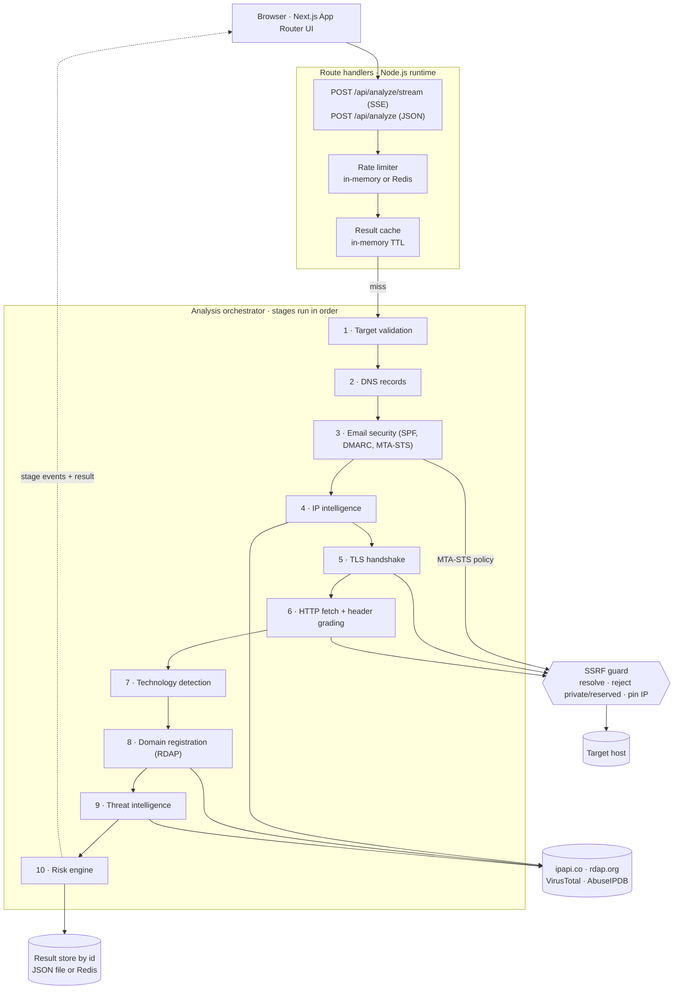

# SentinelScope

**One passive scan of a website, domain, or IP — DNS, TLS, HTTP headers, domain and IP intelligence, and threat reputation — turned into a transparent, evidence-backed risk score.**

[](https://github.com/mehmet-yuksell/sentinelscope-security/actions/workflows/ci.yml)
[](LICENSE)
[](CHANGELOG.md)
[](https://sentinelscope-nu.vercel.app)

**Live demo:** [sentinelscope-nu.vercel.app](https://sentinelscope-nu.vercel.app)

SentinelScope is a passive reconnaissance tool, not an attack tool: it
fetches the target's front page once (following redirects, falling back from
HTTPS to HTTP if needed), opens one TLS handshake, and queries public DNS,
RDAP, and reputation sources. See [Security](#security) and
[Responsible Use](#responsible-use).

---

## Highlights

- **Real data only.** Every value on screen comes from a real lookup. A
  provider with nothing to report is shown as *Unavailable* — never a
  plausible-looking placeholder. If no factor can be measured at all, the
  result is *Insufficient Data*, not a score.
- **Explainable risk score.** A weighted average of eight independently
  scored factors; factors without data are excluded rather than counted as
  safe. Every finding carries severity, evidence, and a concrete fix.
- **Live pipeline.** Each stage's real completion is streamed to the browser
  over Server-Sent Events — the progress UI is not a timer.
- **SSRF-hardened by design.** Every connection to a user-supplied target,
  including each redirect hop, is resolved, checked against private and
  reserved address space (IPv4, IPv6, and IPv6 transition ranges), and pinned
  to the validated IP.
- **Deploys anywhere.** Vercel (with Upstash Redis), Docker, or a plain Node
  server.

## Features

| Area | What is checked |
| --- | --- |
| DNS | A, AAAA, MX, NS, TXT, CNAME, SOA, CAA (inherited from parent domains per RFC 8659) |
| Email security | SPF (`all` policy, the 10-DNS-lookup limit across nested includes, broken includes), DMARC (policy, `sp=`, `pct=`, reporting, organizational-domain fallback), MTA-STS (record and policy file), TLS-RPT |
| TLS | Real handshake: negotiated protocol, issuer, validity window and days remaining, SANs, trust status, self-signed detection |
| HTTP headers | HSTS, CSP, X-Content-Type-Options, X-Frame-Options, Referrer-Policy, Permissions-Policy — each graded pass / warning / missing |
| Configuration | Server/X-Powered-By version disclosure, plain-HTTP serving without a redirect to HTTPS |
| IP intelligence | ASN, organization, geolocation, reverse DNS, datacenter heuristic |
| Domain intelligence | Registrar, registration/expiry dates, domain age, status flags via RDAP |
| Threat intelligence | VirusTotal and AbuseIPDB reputation (optional API keys) |
| Technology | Passive fingerprinting of web server, CDN, hosting platform, framework, CMS, and analytics from headers and HTML markers |
| Reporting | Shareable per-analysis link and a print-friendly report |
| History | Each visitor's recent scans, stored only in their own browser |

## Why SentinelScope?

There are excellent single-purpose tools, and SentinelScope does not replace
any of them in depth. What it offers is a single, combined first look.

| | SentinelScope | Qualys SSL Labs | SecurityHeaders.com | Shodan |
| --- | --- | --- | --- | --- |
| Primary focus | Combined posture overview | TLS server configuration | HTTP response headers | Internet-wide scan data |
| TLS | One handshake: negotiated version and certificate | Full protocol and cipher-suite audit | — | Certificates seen in its own scans |
| HTTP security headers | Graded | — | Graded, with policy guidance | — |
| DNS & email auth | CAA, SPF, DMARC, MTA-STS, TLS-RPT | CAA | — | — |
| Domain registration & age | Yes (RDAP) | — | — | — |
| Reputation | VirusTotal, AbuseIPDB (with keys) | — | — | — |
| Open ports & services | No — by design | — | — | Yes |
| Scoring | Weighted, explainable risk score | Letter grade | Letter grade | — |
| Delivery | Open source (MIT), self-hostable | Hosted service | Hosted service | Hosted service |

"—" means it is not that tool's focus.

**Use something else when** you need a full TLS configuration audit (SSL
Labs), a dedicated header review with policy guidance (SecurityHeaders.com),
or exposure data for open ports and services (Shodan). SentinelScope is for
the moment before that — a quick, explainable answer to "what does this
target look like from the outside?".

## Architecture



- **Only user-supplied targets go through the SSRF guard**
  (`lib/security/ssrf.ts`, `lib/net/safeRequest.ts`). Calls to the fixed,
  trusted provider APIs do not.
- **Results are stored only by unguessable id** for shareable
  `/analysis/[id]` links. There is deliberately no endpoint that lists past
  analyses; the "recent analyses" list lives in each visitor's
  `localStorage`.
- **Every stage returns a `ProviderResult<T>`** with an explicit status
  (`ok`, `unavailable`, `error`, `not_applicable`), so the UI never has to
  guess whether missing data means "safe" or "unknown".

## Tech Stack

| Layer | Choice |
| --- | --- |
| Framework | Next.js 16 (App Router), React 19, TypeScript (strict) |
| UI | Tailwind CSS, Recharts |
| Validation | Zod |
| Backend | Next.js Route Handlers on the Node.js runtime; Node core `dns`, `tls`, `http`, `https` |
| Storage | JSON file store (local, Docker, VPS) or Upstash Redis (serverless) |
| Testing | Vitest |
| Delivery | Docker (multi-stage, standalone output), GitHub Actions, Dependabot |

## Quick Start

Requires Node.js 22.12 or newer.

```bash
git clone https://github.com/mehmet-yuksell/sentinelscope-security.git
cd sentinelscope-security
npm install
cp .env.example .env
npm run dev
```

Open http://localhost:3000. No API keys are needed to run the full DNS,
TLS, HTTP, IP, and domain pipeline.

### Environment Variables

All variables are optional. Without threat-intelligence keys, those panels
are clearly labeled *Unavailable* and excluded from the score.

| Variable | Purpose | Default |
| --- | --- | --- |
| `VIRUSTOTAL_API_KEY` | Domain/IP reputation via VirusTotal | — |
| `ABUSEIPDB_API_KEY` | IP abuse reputation via AbuseIPDB | — |
| `URLSCAN_API_KEY` | Reserved for a future urlscan.io integration (not used yet) | — |
| `RATE_LIMIT_MAX` | Analyze requests per client IP per window | `10` |
| `RATE_LIMIT_WINDOW_MS` | Rate-limit window in ms | `60000` |
| `ANALYSIS_CACHE_TTL_MS` | How long an identical target is served from cache | `300000` |
| `UPSTASH_REDIS_REST_URL` | Persistent store and shared rate limiting — needed on serverless | — |
| `UPSTASH_REDIS_REST_TOKEN` | Paired with the URL above | — |

Vercel's Upstash integration injects `KV_REST_API_URL` /
`KV_REST_API_TOKEN` instead; both naming schemes are supported.

## How It Works

1. **Target validation** — the input is parsed as a domain, URL, or IP;
   only `http`/`https`, ports 80/443, and public addresses are accepted
   (`lib/validation/target.ts`).
2. **DNS** — standard record types are resolved in parallel; a missing type
   is an empty result, not an error (`services/dns`).
3. **Email security** — SPF is parsed and followed through its include and
   redirect chain to count DNS lookups; DMARC is looked up at the hostname
   and then at the organizational domain (Public Suffix List); MTA-STS and
   TLS-RPT records are read, and the MTA-STS policy file is fetched through
   the SSRF guard. A failed lookup fails the stage rather than reading as
   "no record" (`services/email`).
4. **IP intelligence** — ASN, organization, and geolocation from a keyless
   API, plus a real reverse-DNS lookup (`services/ip`).
5. **TLS** — a real TLS socket to the validated, pinned IP; the certificate
   is inspected (`services/tls`).
6. **HTTP** — one SSRF-safe fetch (HTTPS first) retrieves headers and body;
   headers are graded and the body is reused for technology detection
   (`services/http`, `services/technology`).
7. **Domain** — registration data via RDAP for the registered domain, so
   `www.example.com` reports on `example.com` (`services/domain`).
8. **Threat intelligence** — VirusTotal and AbuseIPDB in parallel, if
   configured (`services/threat-intelligence`).
9. **Risk engine** — each factor is scored 0–100 independently and combined
   into a weighted average (`services/risk-engine`).

## Risk Methodology

| Factor | Weight |
| --- | --- |
| TLS Security | 22% |
| HTTP Security Headers | 20% |
| Threat Intelligence | 14% |
| Domain Reputation | 12% |
| IP Reputation | 12% |
| Configuration Findings | 8% |
| DNS Configuration | 6% |
| Email Security | 6% |

Email Security is excluded for a domain that neither receives mail nor
publishes any SPF or DMARC record. A missing MTA-STS policy is reported as
information only and does not raise the score.

A factor whose data is unavailable — no API key, a failed lookup — is
**excluded** and the remaining weights are renormalized, so the score only
reflects evidence that was actually gathered. If no factor has data, the
result is reported as *Insufficient Data* with no score or grade.

```text
0–19   Very Low
20–39  Low
40–59  Moderate
60–79  High
80–100 Critical
```

The exact rules behind each factor and finding are in
`services/risk-engine/index.ts`, and summarized on the in-app
[Methodology](https://sentinelscope-nu.vercel.app/methodology) page.

## Security

- **SSRF protection.** Loopback, RFC 1918, link-local (including the
  `169.254.169.254` cloud metadata address), carrier-grade NAT, multicast,
  documentation and reserved ranges are blocked, together with their IPv6
  equivalents and IPv6 transition forms that can embed an IPv4 address
  (IPv4-mapped, IPv4-compatible, NAT64, 6to4, Teredo). Every redirect hop is
  re-validated and each connection is pinned to its validated IP, closing
  the DNS-rebinding time-of-check/time-of-use gap.
- **Input validation.** Only `http`/`https`, ports 80/443, and URLs without
  embedded credentials are accepted.
- **Rate limiting** per client IP, shared across instances when Redis is
  configured (`lib/rateLimit.ts`).
- **Timeouts and caps.** Each outbound HTTP hop has a hard deadline (8 s by
  default), at most 5 redirects, and a 2 MB response cap; TLS, RDAP, IP and
  reputation lookups have their own timeouts.
- **Secrets stay on the server.** Provider API keys are read only inside
  `services/threat-intelligence` and never reach the client.
- **No cross-visitor history.** Analyses are retrievable only by their
  unguessable UUID; there is no "list everything" endpoint.
- **Dependency hygiene.** Dependabot opens weekly update PRs, and CI fails
  on high or critical advisories in runtime dependencies.

Found a vulnerability? Please follow [SECURITY.md](SECURITY.md) rather than
opening a public issue.

## Deployment

### Vercel

The API routes open raw TLS/DNS sockets, so they run as Node.js functions
(`export const runtime = "nodejs"`), which Vercel supports without extra
configuration.

Serverless instances are stateless, so the default JSON file store and the
in-memory rate limiter are not shared between requests. Add Redis:

1. Create a free database at [console.upstash.com](https://console.upstash.com/redis),
   or add the Upstash for Redis integration from the Vercel Marketplace
   (it sets the variables for you).
2. Import the repository at [vercel.com/new](https://vercel.com/new).
3. Under **Settings → Environment Variables**, add
   `UPSTASH_REDIS_REST_URL` and `UPSTASH_REDIS_REST_TOKEN`, plus any
   threat-intelligence keys.
4. Deploy.

Without Redis the pipeline still works on every request; only
`/analysis/[id]` links and rate limiting become unreliable across instances.

### Docker / VPS

```bash
docker compose up --build
```

Builds the multi-stage image (Next.js standalone output), serves the app on
http://localhost:3000, and persists results to a named volume. API keys are
read from a `.env` file in the project root or from the shell environment.

## Testing

```bash
npm run lint
npm run typecheck
npm test
npm run build
```

CI runs all four on every push to `main` and every pull request, plus a
production dependency audit.

- **Unit tests** — target validation and port rules, SSRF address ranges
  (IPv4, IPv6, transition forms), HTTP header grading, CAA inheritance,
  registered-domain detection, email security (SPF parsing and lookup
  counting, DMARC discovery, MTA-STS) against an in-memory DNS, the TLS port
  guard, and risk-engine scoring and findings (`tests/unit/`).
- **Integration tests** — the SSRF-safe HTTP client against a local server
  (body capture, size cap, redirects, timeouts and stalled responses), and
  the `/api/analyze` route handler (validation, success, caching, error
  mapping, rate limiting) with the pipeline mocked (`tests/integration/`).

No test depends on live network access.

## Project Structure

```text
sentinelscope-security/
├── app/                        # App Router pages and API routes
│   ├── api/analyze/            # POST /api/analyze (JSON) and /stream (SSE)
│   ├── api/analysis/[id]/      # GET a stored analysis by id
│   └── analysis/[id]/          # Dashboard and print-friendly report
├── components/                 # UI (dashboard/, form, pipeline progress)
├── lib/
│   ├── security/ssrf.ts        # Reserved address space checks
│   ├── net/safeRequest.ts      # SSRF-safe HTTP client with IP pinning
│   ├── validation/target.ts    # Target parsing and validation
│   ├── dns/registrableDomain.ts # Registered domain via the Public Suffix List
│   ├── store/                  # File store and Redis store (by id only)
│   └── rateLimit.ts, cache.ts, store.ts, analyzeShared.ts
├── services/                   # dns, email, ip, tls, http, technology,
│   │                           # domain, threat-intelligence, risk-engine
│   └── orchestrator.ts         # Runs the pipeline
├── types/analysis.ts           # The normalized AnalysisResult model
├── utils/                      # Display helpers, browser-only history
├── tests/unit/, tests/integration/
└── Dockerfile, docker-compose.yml, .github/
```

## Limitations

- **TLS analysis is a single handshake.** It reports the negotiated protocol
  and certificate, not the full set of protocols and cipher suites a server
  accepts.
- **Threat intelligence needs API keys.** Without them those factors are
  *Unavailable* and excluded from the score — intentionally.
- **DKIM is not checked.** DKIM keys live under selectors each sender
  chooses (`<selector>._domainkey.<domain>`), which can't be discovered from
  DNS; guessing common selectors would report "missing" for domains that are
  in fact signed.
- **MTA-STS policy certificates are not validated.** The policy file is
  fetched and parsed, but whether its HTTPS certificate would satisfy a
  sending mail server is not checked.
- **RDAP coverage varies by TLD**, and the keyless IP-intelligence provider
  may rate-limit; both degrade to *Unavailable*.
- **The datacenter flag is a heuristic** based on the organization name.
- **No authentication.** This is a public demo by design; add
  authentication before running it as anything more than a personal
  instance.

### Real Data Priority

1. Real API or real local analysis
2. A clearly labeled *Unavailable* or *Not Applicable* state
3. Never: a fabricated score, reputation verdict, or vulnerability

## Responsible Use

SentinelScope performs **passive, non-destructive** checks only: DNS
resolution, one TLS handshake, a single front-page fetch (following
redirects), and public reputation lookups. It never attempts exploitation, credential
attacks, brute forcing, port scanning, or denial of service. Use it only
against targets you are authorized to assess.

## Contributing

Issues and pull requests are welcome — see [CONTRIBUTING.md](CONTRIBUTING.md).
Release notes are in [CHANGELOG.md](CHANGELOG.md).

## Author

**Mehmet Yüksel** · [github.com/mehmet-yuksell](https://github.com/mehmet-yuksell)

Licensed under the [MIT License](LICENSE).
